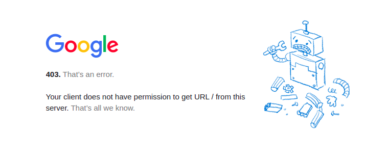

# no-sanction

## Introduction

<p align="center">
  
</p>

**Tired of seeing this page?** Have you ever wondered why you should even face this problem? If you think you DO DESERVE a normal life like others all around the world, stand up for your rights.

There are many unfair sanctions against our country. Here I want to describe the ways in which we can switch services to have a nicer experience with those who respect our nationality.
The rule of thumb here is to avoid online services as much as you can.

## Do you have some sympathy too?

If you've replaced a service under sanctions with an alternative and you are satisfied with it, let us all know!

## Resources

- [Awesome Privacy](https://github.com/pluja/awesome-privacy)
- [Sites that sanction Iran](https://gist.github.com/alibo/dfd7c258bcc44a0e8c9f7c5bfd3bd2c3)

## Services ⚙️

### Gmail

[@1995parham](https://github.com/1995parham):
I have switched to [Tutanota](https://mail.tutanota.com/) instead of Gmail. The experience is great, and you can buy its subscription with the help of [Iranicard](https://www.iranicard.ir/) without any problem.
The switching process is easy, but you must somehow let others know about your new address; I am using Gmail's vacation responder for that.
The Persian support is good, and its font is readable to me. It doesn't have any label system and cannot follow threads, but I think these features are unique to Gmail.
I am using folders and archiving emails instead of tagging them, and I follow threads manually by the email itself.

### Chrome

#### Browser and Bookmarks

[@1995parham](https://github.com/1995parham):
Firefox is awesome 💃. It works for me for reading and checking websites. I don't use browsers for listening to music, etc.

#### Password Manager

[@1995parham](https://github.com/1995parham):
I store my passwords using [gopass](https://github.com/gopasspw/gopass) on GitHub.

### DockerHub

[@1995parham](https://github.com/1995parham):
GitHub Container Registry is faster, free, and respects nationalities. You only need to build and push your images into it by using GitHub Actions.
Consider the following example:

```yaml
docker:
  name: docker
  runs-on: ubuntu-latest
  needs:
    - lint
    - test
  steps:
    - uses: actions/checkout@v7
    - uses: docker/setup-qemu-action@v4
    - uses: docker/setup-buildx-action@v4
    - uses: docker/login-action@v4
      with:
        registry: ghcr.io
        username: ${{ github.repository_owner }}
        password: ${{ secrets.GITHUB_TOKEN }}
    - uses: docker/metadata-action@v6
      id: meta
      with:
        images: ghcr.io/1995parham/saf
        tags: |
          type=ref,event=branch
          type=ref,event=pr
          type=semver,pattern={{version}}
          type=semver,pattern={{major}}.{{minor}}
    - uses: docker/build-push-action@v7
      with:
        file: "build/package/Dockerfile"
        context: .
        platforms: linux/amd64
        push: true
        tags: ${{ steps.meta.outputs.tags }}
        labels: ${{ steps.meta.outputs.labels }}
```

### Docker

[@1995parham](https://github.com/1995parham):
[Podman](https://github.com/containers/podman) is a safer alternative to Docker with a more welcoming community. I only use it on Linux,
and it takes more time to set up compared to Docker, but it doesn't solve the DockerHub sanctions. You can check my setup in [dotfiles](https://github.com/1995parham/dotfiles/blob/main/scripts/podman.sh).

### AWS, Google Cloud, Hetzner

Signing up is the wall here: AWS and Google Cloud reject Iranian users outright, and Hetzner suspends accounts once the country is known. Iranian providers have no such problem, they take rial directly, and they keep latency inside the country.

- [ArvanCloud](https://www.arvancloud.ir/en) offers a CDN, cloud servers, S3-compatible object storage, and managed Kubernetes.
- [Hamravesh](https://hamravesh.com/) offers [managed Kubernetes](https://hamravesh.com/managed-kubernetes), [Darkube](https://hamravesh.com/darkube) as a PaaS on top of it, and a [container registry](https://docs.hamravesh.com/container-registry/introduction/) you can push to instead of DockerHub.
- [Liara](https://liara.ir/) offers a PaaS with managed databases and object storage.
- [Parspack](https://parspack.com/) offers VPSes, dedicated servers, and domains.

If you want to move your repositories off GitHub as well, [hamgit.ir](https://hamgit.ir/) is a hosted GitLab.

The tradeoff is worth stating plainly: these providers sit inside Iran, so they answer to local regulation in a way a foreign provider does not. That is a different set of constraints, not an absent one.

### Google Keep

[@1995parham](https://github.com/1995parham):
I write my notes in Emacs [org-mode](https://orgmode.org/) and sync them with GitHub. You need to learn org-mode first, and that took me 3 or 4 weeks.

### Overleaf

[@1995parham](https://github.com/1995parham):
I write my LaTeX documents on my own system. With a few scripts it is far better than the Overleaf experience. You can check my [dotfiles](https://github.com/1995parham/dotfiles/blob/main/scripts/tex.sh) for installing TeX Live.

[@elaheh-dastan](https://github.com/elaheh-dastan):
I used to write my thesis in LaTeX using Overleaf. Not only is it hard to write Persian in Overleaf, but it also frustrated me that every day I had to change my VPN because the former one had been recognized. So I started to use Emacs and keep the files in my GitHub repository, and even the experience of writing Persian in Emacs is way better.

### Trello

[@1995parham](https://github.com/1995parham):
I use Emacs [org-mode](https://orgmode.org/) for my tasks and for tracking them, without any problem. I also sync them with GitHub.

### Golang

[@1995parham](https://github.com/1995parham):
Sadly I must use Go because it is my primary language, but sites like [go.dev](https://go.dev/) are free. Currently I am trying to switch.
Languages like [Rust](https://www.rust-lang.org/) or [Zig](https://ziglang.org/) are free and awesome replacements for Go.

### Dropbox, Google Drive

[@1995parham](https://github.com/1995parham):
I use [Syncthing](https://github.com/syncthing/syncthing) to share files between my systems without any issue.

### Tensorflow

[@mhezarei](https://github.com/mhezarei): While developing Deep Learning models, one might need to read the framework's documentation or download its pre-trained models. You need to get past the "sanction page" to do anything that needs downloading/loading from the TensorFlow website.

[PyTorch](https://pytorch.org/), on the other hand, won't bother you with any of these difficulties, and you can develop and learn about Deep Learning without any worries. It is a well-known framework that doesn't need much of an introduction.

PyTorch **will** provide you with almost everything TensorFlow offers with no form of sanctions or bans. You can read the website's documentation for more information.
